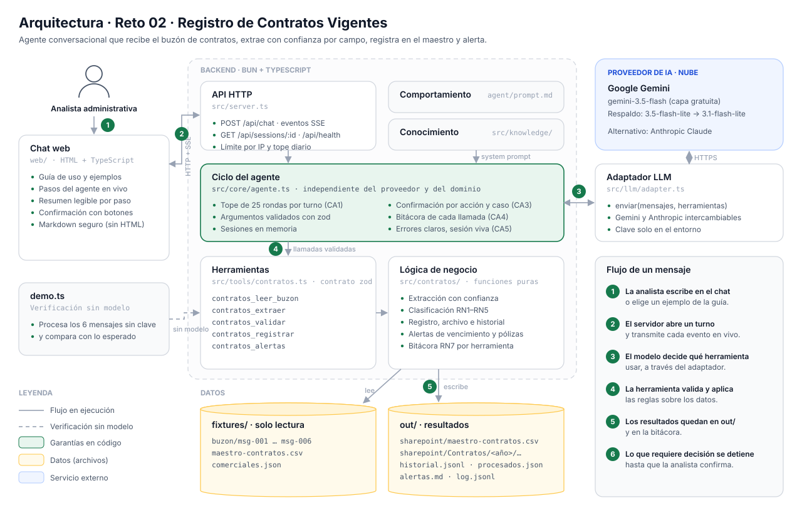

# Reto 02 — Agente conversacional "Registro de Contratos Vigentes"

Agente que actúa como **punto único de recepción** del buzón de contratos. Lee cada correo, extrae los datos del contrato con un nivel de confianza por campo y lo clasifica como nuevo, actualización (otrosí), duplicado o rechazado. Luego lo registra en el maestro de un SharePoint simulado, archiva el documento y produce las alertas de vencimiento y de pólizas. Lo dudoso (confianza < 0,8) no se registra hasta que la analista lo confirme.

- **Link de prueba:** https://reto-02-luis-torrenegra.onrender.com (Render, plan gratuito: la primera visita puede tardar ~50 s en despertar)
- **Planteamiento de la solución y regla de gobierno:** [`SOLUCION.md`](SOLUCION.md)
- **PRD del reto:** entregado por Periferia IT Group; no se publica en este repositorio

La interfaz se explica sola: la pantalla inicial muestra cómo funciona, ejemplos con lo que se puede esperar y los datos de prueba disponibles, y el botón **Guía de uso** abre un manual con las confirmaciones, la lectura de la pantalla, los resultados y los límites. El contenido de la guía está en `src/presentacion.ts`.



## Puesta en marcha (un comando)

```bash
bun install
cp .env.example .env     # pega tu clave gratuita de https://aistudio.google.com/apikey en LLM_API_KEY
bun run dev              # front + backend en http://localhost:3000
```

Con Docker: `docker build -t reto-02 . && docker run -p 3000:3000 --env-file .env reto-02`.

## Verificación sin modelo de lenguaje

```bash
bun install && bun run demo.ts
```

Procesa los 6 mensajes del buzón en orden llamando directamente a las herramientas, sin ninguna clave. Por mensaje imprime clasificación, campos en revisión y acción tomada. msg-006 queda sin registrar en la primera pasada, y luego se muestra la segunda llamada con `confirmado: true`. Al final verifica el maestro y genera las alertas con fecha 2026-09-03. `out/` se limpia al inicio, así que la demo es determinista.

| Mensaje | Clasificación | Acción |
|---|---|---|
| msg-001 | nuevo | Alta de CT-2026-015, póliza `pendiente` |
| msg-002 | nuevo | Alta de CT-2026-016, `no_aplica` |
| msg-003 | actualización (otrosí) | CT-2026-011: valor, fecha fin y póliza → `pendiente`; queda en el historial |
| msg-004 | duplicado | Sin escritura |
| msg-005 | rechazado | Es una cotización, no un contrato |
| msg-006 | nuevo con revisión (`valor`, `fecha_fin`) | Se registra tras confirmar |

Otros comandos: `bun test` (sin clave), `bun run typecheck`, `bun run modulo` (regenera `modulo/`).

## Variables de entorno

| Variable | Uso | Por defecto |
|---|---|---|
| `LLM_PROVIDER` | Proveedor de lenguaje: `gemini` o `anthropic` | `gemini` |
| `LLM_MODEL` | Modelo; vacío = el del proveedor | `gemini-3.5-flash` (respaldo automático a `gemini-3.5-flash-lite` y `gemini-3.1-flash-lite`) |
| `LLM_API_KEY` | Clave del proveedor. Solo en el entorno del backend: nunca en el repo, el front, los logs ni la API | — |
| `LLM_TIMEOUT_MS` | Tiempo máximo de espera al proveedor | `120000` |
| `MAX_ITERACIONES` | Rondas herramienta → modelo por turno | `25` |
| `MAX_TOKENS_SESION` | Tope de tokens por conversación | `500000` |
| `MAX_TOKENS_DIA` | Tope diario de tokens para todo el servidor (el link es público) | `3000000` |
| `MAX_MENSAJES_POR_IP` / `VENTANA_MINUTOS` | Mensajes permitidos por IP en cada ventana | `30` cada `10` minutos |
| `FECHA_REFERENCIA` | Fecha de referencia del negocio. `2026-09-03` reproduce el escenario de la prueba | hoy |
| `PORT` | Puerto HTTP | `3000` |

## API

| Método | Ruta | Descripción |
|---|---|---|
| `POST` | `/api/chat` | `{ sessionId, message }` → stream SSE de eventos: `texto`, `llamada`, `resultado`, `error`, `fin_turno` (`necesitaConfirmacion`, uso de tokens) |
| `GET` | `/api/sessions/:id` | Historial completo de la sesión |
| `DELETE` | `/api/sessions/:id` | Descarta la sesión |
| `GET` | `/api/health` | `{ ok, provider, model }`, sin exponer claves |
| `GET` | `/api/herramientas` | Herramientas registradas |
| `GET` | `/api/info` | Título, descripción y sugerencias que muestra el chat |

La referencia de la sección 6.4 del PRD (`{ reply, toolCalls[], needsConfirmation }`) se entrega como stream: el texto llega en eventos `texto`, cada llamada en `llamada` y `resultado`, y `fin_turno` trae `necesitaConfirmacion`. `POST /api/chat` responde 429 si una IP supera su límite de mensajes.

## Herramientas

| Herramienta | Qué hace |
|---|---|
| `contratos_leer_buzon` | Mensajes no procesados, con `tiene_contrato`; los que no traen contrato salen como `rechazado` |
| `contratos_extraer` | Datos del contrato u otrosí con confianza y evidencia por campo |
| `contratos_validar` | Clasificación RN1–RN4, `requiere_revision` (RN5), diferencias con el maestro y advertencias |
| `contratos_registrar` | Escribe el maestro, archiva el documento, agrega una línea al historial y marca el mensaje como procesado. Sin `confirmado`, rechaza lo que está en revisión |
| `contratos_alertas` | `out/alertas.md`: vencen en ≤ 60 días, pólizas pendientes y registrados desde el corte |

Cada ejecución deja `{ ts, herramienta, mensaje_id, ok, resumen }` en `out/log.jsonl` (RN7).

## Estructura

```
agent/prompt.md                   comportamiento (system prompt)
src/knowledge/registro-contratos.md   conocimiento del proceso (RN1–RN7, maestro, alertas)
src/tools/contratos.ts            herramientas: { description, args (zod), execute } → contratos_<export>
src/contratos/                    lógica: texto, extracción, clasificación, registro, alertas, CSV
src/core/                         ciclo del agente, confirmación, sesiones (genérico)
src/llm/                          adaptador LLM neutral + Gemini y Anthropic
src/server.ts                     API HTTP + SSE
web/                              chat (HTML + TypeScript, sin framework)
modulo/                           bonus: agente empaquetado (generado de las mismas fuentes)
fixtures/reto-02/                 datos entregados (solo lectura)
out/                              generado: sharepoint/, procesados.json, alertas.md, log.jsonl
```
